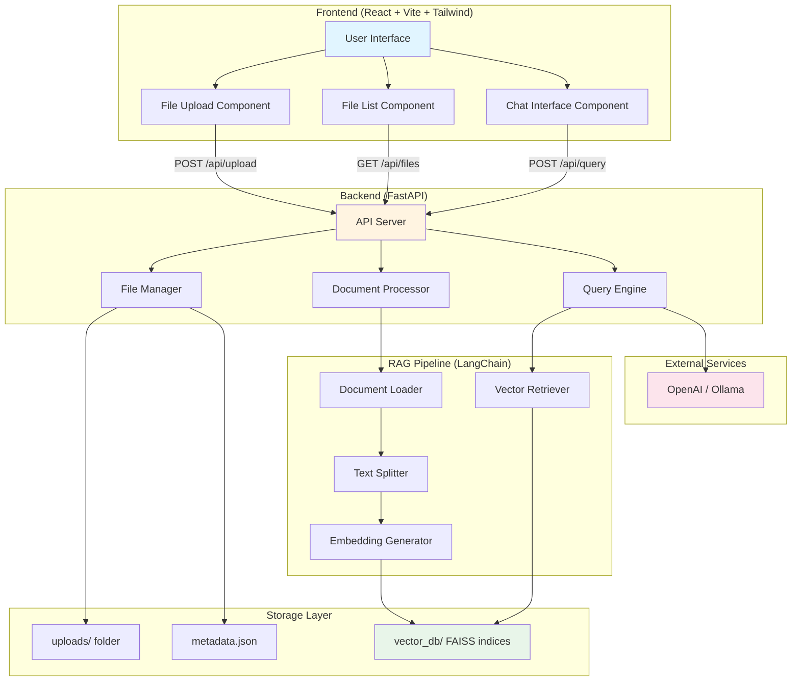
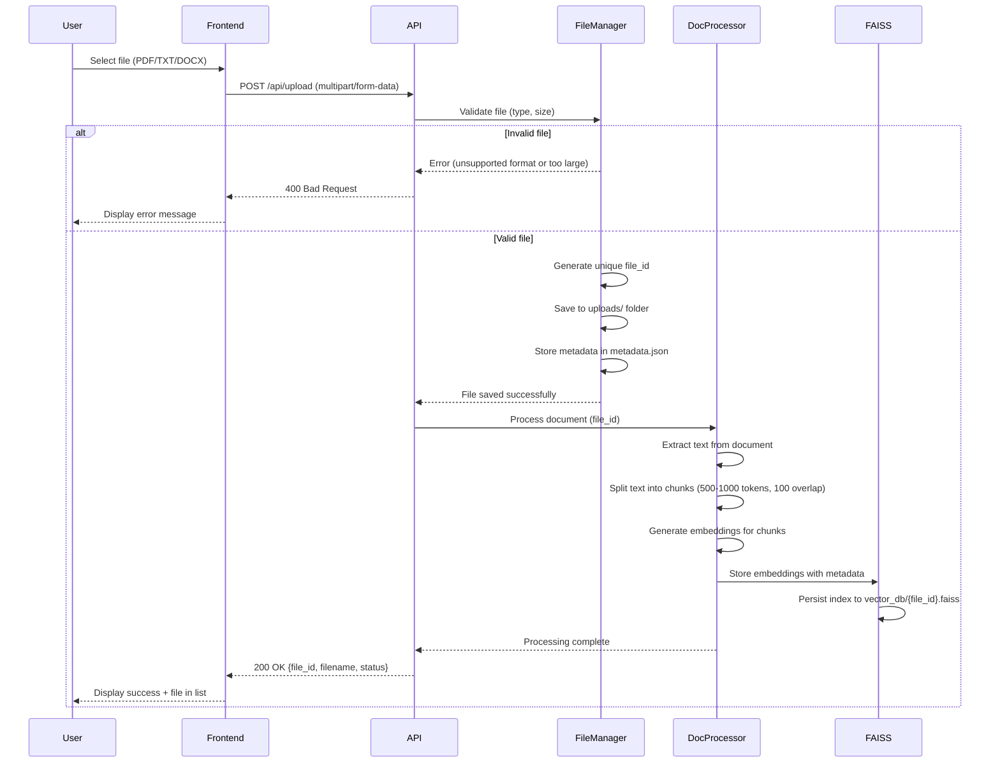
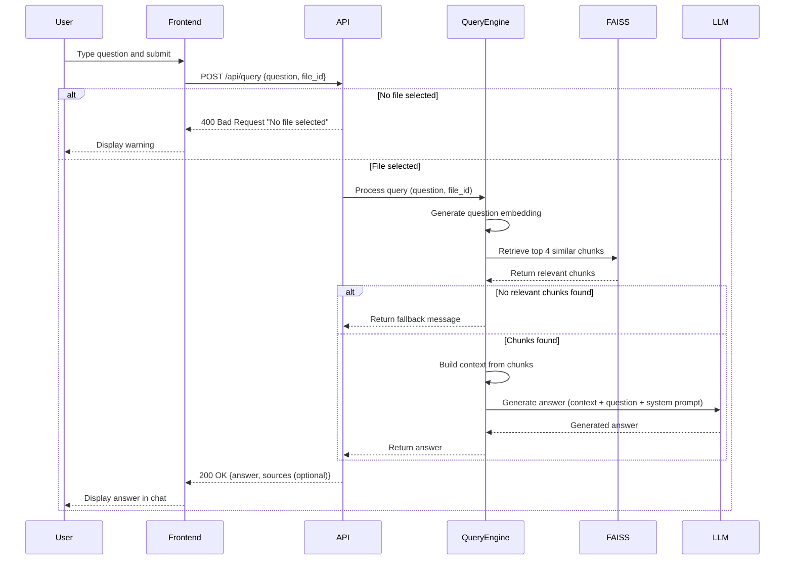

# Design Document: RAG Web Application

## Overview

The RAG Web Application is a standalone, self-contained Retrieval-Augmented Generation system that enables users to upload documents and ask questions answered strictly from the document content. The application is designed as an independent project within a `RAG/` folder at the workspace root, ensuring complete portability and separation from existing systems.

### Key Design Principles

1. **Self-Containment**: All code, dependencies, storage, and configuration reside within the `RAG/` folder
2. **File-Based Storage**: No external database dependencies; uses local file system for uploads and FAISS indices
3. **Strict Context Grounding**: LLM responses are constrained to document content only, with explicit fallback messages
4. **Production-Ready**: Includes error handling, loading states, validation, and guardrails
5. **Technology Stack**: FastAPI backend, React + Vite + Tailwind frontend, LangChain for RAG pipeline, FAISS for vector storage

### Architecture Summary

The system follows a client-server architecture with clear separation of concerns:

- **Frontend (React + Vite)**: User interface for file upload, file selection, and chat interaction
- **Backend (FastAPI)**: REST API handling file uploads, document processing, and query answering
- **RAG Pipeline (LangChain)**: Document loading, text splitting, embedding generation, and retrieval
- **Vector Store (FAISS)**: Persistent vector database for semantic search
- **LLM Integration**: OpenAI or Ollama for answer generation with strict system prompts

## Architecture

### System Architecture Diagram



### Data Flow

#### File Upload Flow



#### Query Answering Flow



## Components and Interfaces

### Backend Components

#### 1. File Manager (`backend/utils/file_handler.py`)

**Responsibilities:**
- Handle file uploads and validation
- Generate unique file IDs
- Store files in the uploads/ directory
- Manage file metadata in metadata/ directory

**Key Functions:**

```python
async def save_uploaded_file(file: UploadFile) -> dict:
    """
    Save uploaded file to uploads/ directory
    
    Args:
        file: UploadFile object from FastAPI
    
    Returns:
        dict: {file_id, filename, filepath, upload_time}
    
    Raises:
        ValueError: If file type not supported or size exceeds limit
    """

def validate_file(file: UploadFile) -> tuple[bool, str]:
    """
    Validate file type and size
    
    Args:
        file: UploadFile object
    
    Returns:
        tuple: (is_valid, error_message)
    """

def save_metadata(file_id: str, metadata: dict) -> None:
    """
    Save file metadata to JSON file
    
    Args:
        file_id: Unique file identifier
        metadata: Dictionary containing file information
    """

def load_metadata(file_id: str) -> dict:
    """
    Load file metadata from JSON file
    
    Args:
        file_id: Unique file identifier
    
    Returns:
        dict: File metadata
    
    Raises:
        FileNotFoundError: If metadata file doesn't exist
    """

def list_all_files() -> list[dict]:
    """
    List all uploaded files with metadata
    
    Returns:
        list: List of file metadata dictionaries
    """
```

**Metadata Structure:**
```json
{
  "file_id": "550e8400-e29b-41d4-a716-446655440000",
  "filename": "document.pdf",
  "original_filename": "My Document.pdf",
  "upload_time": "2024-01-15T10:30:00Z",
  "file_size": 1024000,
  "file_type": "pdf",
  "status": "processed",
  "chunk_count": 45,
  "vector_index_path": "vector_db/550e8400.faiss",
  "error_message": null
}
```

#### 2. Document Processor (`backend/core/document_processor.py`)

**Responsibilities:**
- Extract text from PDF, TXT, DOCX files
- Handle OCR for scanned PDFs
- Split text into chunks
- Generate embeddings
- Create and persist FAISS indices

**Key Functions:**

```python
def extract_text(file_path: str, file_type: str) -> str:
    """
    Extract text from document
    
    Args:
        file_path: Path to uploaded file
        file_type: File extension (pdf, txt, docx)
    
    Returns:
        str: Extracted text
    
    Raises:
        Exception: If text extraction fails
    """

def chunk_text(text: str, chunk_size: int = 500, overlap: int = 100) -> list[str]:
    """
    Split text into overlapping chunks
    
    Args:
        text: Document text
        chunk_size: Target chunk size in tokens
        overlap: Overlap between chunks in tokens
    
    Returns:
        list: List of text chunks
    """

def generate_embeddings(chunks: list[str], model_name: str = "all-MiniLM-L6-v2") -> np.ndarray:
    """
    Generate embeddings for text chunks
    
    Args:
        chunks: List of text chunks
        model_name: Sentence transformer model name
    
    Returns:
        np.ndarray: Embedding matrix (shape: [n_chunks, embedding_dim])
    """

async def process_document(file_id: str, file_path: str, file_type: str) -> dict:
    """
    Complete document processing pipeline
    
    Args:
        file_id: Unique file identifier
        file_path: Path to uploaded file
        file_type: File extension
    
    Returns:
        dict: {status, chunk_count, index_path, error_message}
    """
```

**Processing Pipeline:**
1. **Text Extraction**: Use pypdf for PDF, python-docx for DOCX, direct read for TXT
2. **OCR Fallback**: If PDF has no extractable text, use pytesseract + pdf2image
3. **Text Chunking**: RecursiveCharacterTextSplitter with 500-1000 token chunks, 100 token overlap
4. **Embedding Generation**: sentence-transformers (all-MiniLM-L6-v2) for 384-dim embeddings
5. **Index Creation**: FAISS IndexFlatL2 for L2 distance similarity search
6. **Persistence**: Save FAISS index and chunks to vector_db/ directory

#### 3. Vector Store (`backend/core/vector_store.py`)

**Responsibilities:**
- Create and manage FAISS indices
- Perform similarity search
- Load and save indices from/to disk

**Key Functions:**

```python
def create_vector_index(embeddings: np.ndarray, chunks: list[str], file_id: str) -> str:
    """
    Create FAISS index from embeddings
    
    Args:
        embeddings: Embedding matrix
        chunks: List of text chunks
        file_id: Unique file identifier
    
    Returns:
        str: Path to saved FAISS index
    """

def load_vector_index(file_id: str) -> tuple:
    """
    Load FAISS index and chunks from disk
    
    Args:
        file_id: Unique file identifier
    
    Returns:
        tuple: (faiss_index, chunks, embedding_model)
    
    Raises:
        FileNotFoundError: If index doesn't exist
    """

def search_similar_chunks(query: str, file_id: str, k: int = 4) -> list[dict]:
    """
    Search for similar chunks using vector similarity
    
    Args:
        query: User question
        file_id: Target file identifier
        k: Number of chunks to retrieve
    
    Returns:
        list: List of {chunk_text, score, index} dictionaries
    """
```

**Storage Structure:**
```
vector_db/
  {file_id}.faiss          # FAISS index binary
  {file_id}_chunks.json    # Chunk text and metadata
```

#### 4. Query Engine (`backend/core/query_engine.py`)

**Responsibilities:**
- Retrieve relevant chunks for questions
- Construct prompts with strict context constraints
- Call LLM (OpenAI or Ollama)
- Validate answers and apply fallback logic

**Key Functions:**

```python
async def generate_answer(question: str, file_id: str, model_name: str = None) -> dict:
    """
    Complete RAG pipeline for question answering
    
    Args:
        question: User question
        file_id: Target file identifier
        model_name: Optional LLM model override
    
    Returns:
        dict: {answer, sources, fallback_used}
    """

def retrieve_context(question: str, file_id: str, k: int = 4) -> tuple[str, list[dict]]:
    """
    Retrieve relevant chunks for question
    
    Args:
        question: User question
        file_id: Target file identifier
        k: Number of chunks to retrieve
    
    Returns:
        tuple: (context_string, source_chunks)
    """

def construct_prompt(question: str, context: str) -> tuple[str, str]:
    """
    Build LLM prompt with system instructions
    
    Args:
        question: User question
        context: Retrieved chunks
    
    Returns:
        tuple: (system_prompt, user_prompt)
    """

async def call_llm(system_prompt: str, user_prompt: str, model_name: str = None) -> str:
    """
    Call OpenAI or Ollama API
    
    Args:
        system_prompt: System instructions
        user_prompt: User question with context
        model_name: Model identifier
    
    Returns:
        str: Generated answer
    
    Raises:
        Exception: If LLM service unavailable
    """
```

**System Prompt Template:**
```
You are an AI assistant that answers questions ONLY from the provided context.

STRICT RULES:
1. Answer ONLY using information explicitly stated in the context below
2. If the answer is not in the context, respond EXACTLY with: "The answer is not found in the uploaded file. Please contact your coordinator for better accuracy."
3. Do not use external knowledge or make assumptions
4. Do not guess or infer information not present in the context
5. Be concise and precise
6. Use bullet points for lists
7. Bold important terms with **term**

Context:
{retrieved_chunks}

Question: {user_question}
```

### Frontend Components

#### 1. FileUpload Component (`frontend/src/components/FileUpload.jsx`)

**Purpose**: Handle file selection and upload with progress feedback

**Props:**
```typescript
interface FileUploadProps {
  onUploadComplete: (fileId: string, filename: string) => void;
  onUploadError: (error: string) => void;
}
```

**State:**
```typescript
{
  uploading: boolean;
  progress: number;
  error: string | null;
  dragActive: boolean;
}
```

**Key Methods:**
- `handleFileSelect(file: File)` - Validate and initiate upload
- `uploadFile(file: File)` - POST to /api/upload with progress tracking
- `validateFile(file: File)` - Check file type (PDF/TXT/DOCX) and size (<50MB)
- `handleDragOver/handleDrop` - Drag-and-drop support

**UI Elements:**
- File input button
- Drag-and-drop zone with visual feedback
- Progress bar during upload
- Success/error messages
- Supported formats indicator

#### 2. FileList Component (`frontend/src/components/FileList.jsx`)

**Purpose**: Display uploaded files and handle file selection

**Props:**
```typescript
interface FileListProps {
  selectedFileId: string | null;
  onFileSelect: (fileId: string) => void;
}
```

**State:**
```typescript
{
  files: FileMetadata[];
  loading: boolean;
  error: string | null;
}
```

**Key Methods:**
- `fetchFiles()` - GET /api/files to retrieve file list
- `handleFileClick(fileId: string)` - Select file for querying
- `formatTimestamp(timestamp: string)` - Display-friendly date format
- `refreshFileList()` - Reload file list

**UI Elements:**
- Scrollable file list
- File items with name, timestamp, and status indicator
- Selection highlighting (blue background)
- Empty state message ("No files uploaded yet")
- Processing status indicators

#### 3. ChatInterface Component (`frontend/src/components/ChatInterface.jsx`)

**Purpose**: Handle question input and display conversation history

**Props:**
```typescript
interface ChatInterfaceProps {
  selectedFileId: string | null;
}
```

**State:**
```typescript
{
  messages: Message[];
  inputValue: string;
  loading: boolean;
  error: string | null;
}
```

**Key Methods:**
- `handleSubmit()` - POST question to /api/query
- `handleInputChange(value: string)` - Update input state
- `scrollToBottom()` - Auto-scroll to latest message
- `clearChat()` - Reset conversation history
- `validateInput()` - Check for empty/whitespace-only input

**UI Elements:**
- Message list (scrollable, auto-scroll to bottom)
- User messages (right-aligned, blue background)
- AI messages (left-aligned, gray background)
- Question input box (textarea with auto-resize)
- Submit button (disabled when no file selected or input empty)
- Loading indicator ("Generating answer..." with typing animation)
- Error display

### API Routes (`backend/api/routes.py`)

```python
from fastapi import APIRouter, UploadFile, File, HTTPException
from pydantic import BaseModel

router = APIRouter()

class QueryRequest(BaseModel):
    question: str
    file_id: str
    model: str | None = None

@router.post("/api/upload")
async def upload_file(file: UploadFile = File(...)):
    """
    Upload and process a document
    
    Returns:
        dict: {status, file_id, filename, message, processing_status}
    
    Raises:
        HTTPException: 400 for invalid file, 500 for server error
    """

@router.get("/api/files")
async def list_files():
    """
    List all uploaded files with metadata
    
    Returns:
        dict: {status, files: [{file_id, filename, upload_time, status, chunk_count}]}
    """

@router.post("/api/query")
async def query_document(request: QueryRequest):
    """
    Ask a question about a document
    
    Args:
        request: QueryRequest with question, file_id, optional model
    
    Returns:
        dict: {status, answer, sources, fallback_used}
    
    Raises:
        HTTPException: 400 for invalid request, 404 for file not found, 500 for server error
    """

@router.get("/api/health")
async def health_check():
    """
    Health check endpoint
    
    Returns:
        dict: {status, version, services: {faiss, embeddings, llm}}
    """
```

## Data Models

### FileMetadata

```python
from pydantic import BaseModel
from datetime import datetime

class FileMetadata(BaseModel):
    file_id: str              # UUID
    filename: str             # Sanitized filename
    original_filename: str    # User's original filename
    upload_time: datetime     # Upload timestamp
    file_size: int            # Size in bytes
    file_type: str            # pdf, txt, docx
    status: str               # uploading, processing, processed, error
    chunk_count: int          # Number of chunks created
    vector_index_path: str    # Path to FAISS index
    error_message: str | None # Error details if status is error
```

### Message

```python
class Message(BaseModel):
    id: str                   # Message UUID
    type: str                 # "question" or "answer"
    content: str              # Message text
    timestamp: datetime       # Message timestamp
    file_id: str              # Associated file
    sources: list[Source] | None  # Retrieved chunks (for answers)
```

### Source

```python
class Source(BaseModel):
    chunk_text: str           # Retrieved chunk content
    score: float              # Similarity score (0-1)
    index: int                # Chunk index in document
```

### QueryRequest

```python
class QueryRequest(BaseModel):
    question: str             # User question (non-empty)
    file_id: str              # Target file UUID
    model: str | None = None  # Optional model override (e.g., "gpt-4", "llama2")
```

### QueryResponse

```python
class QueryResponse(BaseModel):
    status: str               # "success" or "error"
    answer: str               # Generated answer or error message
    sources: list[Source]     # Retrieved chunks
    fallback_used: bool       # Whether fallback message was used
```

## Error Handling

### Error Categories

#### 1. File Upload Errors

**Unsupported File Type:**
- **Trigger**: File extension not in [.pdf, .txt, .docx]
- **Response**: 400 Bad Request
- **Message**: "Unsupported file format. Please upload PDF, TXT, or DOCX files."
- **UI Action**: Display error message, clear file input

**File Too Large:**
- **Trigger**: File size > 50MB
- **Response**: 400 Bad Request
- **Message**: "File too large. Maximum size is 50MB."
- **UI Action**: Display error message, clear file input

**Text Extraction Failure:**
- **Trigger**: pypdf/python-docx fails, OCR unavailable or fails
- **Response**: 500 Internal Server Error
- **Message**: "Failed to extract text from document. Please ensure the file is not corrupted."
- **UI Action**: Display error message, mark file as error status

**No Readable Text:**
- **Trigger**: Extracted text is empty or whitespace-only
- **Response**: 400 Bad Request
- **Message**: "No readable text found in document. Please upload a different file."
- **UI Action**: Display error message, remove file from list

#### 2. Query Errors

**No File Selected:**
- **Trigger**: User submits question without selecting a file
- **Response**: 400 Bad Request
- **Message**: "Please select a file before asking questions."
- **UI Action**: Display warning message, highlight file list

**Empty Question:**
- **Trigger**: Question is empty or whitespace-only
- **Response**: 400 Bad Request (or client-side validation)
- **Message**: "Please enter a question."
- **UI Action**: Disable submit button, show validation message

**File Not Found:**
- **Trigger**: file_id doesn't exist in metadata
- **Response**: 404 Not Found
- **Message**: "File not found. Please refresh the file list."
- **UI Action**: Display error message, refresh file list

**Document Not Processed:**
- **Trigger**: File status is "processing" or "error"
- **Response**: 400 Bad Request
- **Message**: "Document not processed. Please wait or re-upload the file."
- **UI Action**: Display error message, show processing status

**LLM Service Unavailable:**
- **Trigger**: OpenAI/Ollama API call fails
- **Response**: 500 Internal Server Error
- **Message**: "AI service temporarily unavailable. Please try again later."
- **UI Action**: Display error message, enable retry

**No Relevant Chunks:**
- **Trigger**: Vector search returns no results or low-confidence results
- **Response**: 200 OK (with fallback message)
- **Message**: "The answer is not found in the uploaded file. Please contact your coordinator for better accuracy."
- **UI Action**: Display fallback message in chat

#### 3. System Errors

**FAISS Index Corruption:**
- **Trigger**: FAISS index file corrupted or incompatible
- **Response**: 500 Internal Server Error
- **Message**: "Vector index corrupted. Please re-upload the file."
- **UI Action**: Display error message, mark file as error status

**Disk Space Full:**
- **Trigger**: Insufficient disk space for file upload or index storage
- **Response**: 507 Insufficient Storage
- **Message**: "Server storage full. Please contact administrator."
- **UI Action**: Display error message

**Environment Configuration Error:**
- **Trigger**: Missing API keys or invalid configuration
- **Response**: 500 Internal Server Error
- **Message**: "Server configuration error. Please contact administrator."
- **UI Action**: Display error message

### Error Handling Strategy

**Backend Error Handling:**
```python
from fastapi import HTTPException
import logging

logger = logging.getLogger(__name__)

try:
    # Operation
    result = process_document(file_path)
except ValueError as e:
    # Client error (bad input)
    logger.warning(f"Validation error: {e}")
    raise HTTPException(status_code=400, detail=str(e))
except FileNotFoundError as e:
    # Resource not found
    logger.error(f"File not found: {e}")
    raise HTTPException(status_code=404, detail="File not found")
except Exception as e:
    # Server error
    logger.error(f"Unexpected error: {e}", exc_info=True)
    raise HTTPException(status_code=500, detail="Internal server error")
```

**Frontend Error Handling:**
```javascript
try {
  const response = await axios.post('/api/query', { question, file_id });
  setAnswer(response.data.answer);
} catch (error) {
  if (error.response) {
    // Server responded with error status
    const message = error.response.data.message || 'An error occurred';
    setError(message);
  } else if (error.request) {
    // Request made but no response
    setError('Server not responding. Please try again later.');
  } else {
    // Request setup error
    setError('Failed to send request. Please check your connection.');
  }
}
```

## Testing Strategy

### Property-Based Testing Applicability

**Assessment: Property-Based Testing is NOT appropriate for this feature.**

**Rationale:**
- The RAG Web Application is primarily an **integration-heavy system** involving file I/O, external services (LLM APIs, embedding models), vector database operations, and UI rendering
- Core operations are **side-effect driven** (file uploads, API calls, database writes) rather than pure functions
- Document processing relies on **external libraries** (pypdf, langchain, sentence-transformers, FAISS) whose behavior is already tested by their authors
- LLM responses are **non-deterministic** and depend on external service behavior
- UI components are best tested with **snapshot tests and example-based tests**

**Testing Approach:**
Instead of property-based testing, this feature will use:
1. **Unit tests** with mocks for isolated component logic
2. **Integration tests** for end-to-end workflows
3. **Example-based tests** for specific scenarios and edge cases
4. **Manual testing** for UI/UX validation

### Unit Testing

**Backend Unit Tests (pytest):**

**File Validation (`test_file_handler.py`):**
- Test valid file types (PDF, TXT, DOCX) are accepted
- Test invalid file types (JPG, EXE, etc.) are rejected
- Test file size validation (under 50MB passes, over 50MB fails)
- Test filename sanitization (remove special characters, prevent path traversal)
- Test metadata save/load operations
- Test file listing with multiple files

**Text Extraction (`test_document_processor.py`):**
- Test PDF text extraction with sample PDF containing text
- Test TXT file reading
- Test DOCX text extraction with sample DOCX
- Test empty file handling
- Test corrupted file handling
- Mock OCR functionality for scanned PDFs

**Text Chunking (`test_document_processor.py`):**
- Test chunk size and overlap configuration
- Test chunking with short text (< chunk size)
- Test chunking with long text (multiple chunks)
- Test empty text handling
- Test whitespace-only text handling

**Embedding Generation (`test_document_processor.py`):**
- Test embedding shape matches expected dimensions (384 for all-MiniLM-L6-v2)
- Test embedding consistency (same input → same output)
- Test batch embedding generation
- Mock sentence-transformers model for faster tests

**Vector Store Operations (`test_vector_store.py`):**
- Test FAISS index creation with sample embeddings
- Test index save/load operations
- Test similarity search with known query and expected results
- Test handling of non-existent file_id
- Mock FAISS operations for faster tests

**Prompt Construction (`test_query_engine.py`):**
- Test system prompt formatting
- Test context insertion into prompt
- Test prompt length limits
- Test special character handling in questions

**LLM Integration (`test_query_engine.py`):**
- Mock OpenAI API calls and test response handling
- Mock Ollama API calls and test response handling
- Test API error handling (timeout, rate limit, invalid key)
- Test fallback message logic

**Frontend Unit Tests (Jest + React Testing Library):**

**FileUpload Component (`FileUpload.test.jsx`):**
- Test file selection triggers upload
- Test file validation (type and size)
- Test upload progress display
- Test success callback invocation
- Test error callback invocation
- Test drag-and-drop functionality

**FileList Component (`FileList.test.jsx`):**
- Test file list rendering with mock data
- Test empty state display
- Test file selection highlighting
- Test file click handler
- Test loading state display

**ChatInterface Component (`ChatInterface.test.jsx`):**
- Test message rendering (user and AI messages)
- Test input validation (empty input disables submit)
- Test submit handler with valid input
- Test loading state during answer generation
- Test error message display
- Test auto-scroll to bottom

**API Service (`api.test.js`):**
- Test request formatting for each endpoint
- Test error handling for network errors
- Test error handling for API errors (400, 404, 500)
- Mock axios for all tests

### Integration Testing

**End-to-End Workflows (pytest with test files):**

**Test 1: Complete Upload and Process Flow**
```python
def test_upload_and_process_pdf():
    # Upload sample PDF
    response = client.post("/api/upload", files={"file": sample_pdf})
    assert response.status_code == 200
    file_id = response.json()["file_id"]
    
    # Wait for processing
    time.sleep(2)
    
    # Verify metadata
    metadata = load_metadata(file_id)
    assert metadata["status"] == "processed"
    assert metadata["chunk_count"] > 0
    
    # Verify FAISS index exists
    assert os.path.exists(f"vector_db/{file_id}.faiss")
```

**Test 2: Query and Answer Flow**
```python
def test_query_with_answer_in_document():
    # Setup: Upload and process document
    file_id = upload_test_document()
    
    # Query with question that has answer in document
    response = client.post("/api/query", json={
        "question": "What is the main topic?",
        "file_id": file_id
    })
    
    assert response.status_code == 200
    data = response.json()
    assert data["status"] == "success"
    assert len(data["answer"]) > 0
    assert data["fallback_used"] == False
```

**Test 3: Fallback Logic**
```python
def test_query_with_no_relevant_context():
    # Setup: Upload document about topic A
    file_id = upload_test_document()
    
    # Query about completely unrelated topic B
    response = client.post("/api/query", json={
        "question": "What is quantum mechanics?",
        "file_id": file_id
    })
    
    assert response.status_code == 200
    data = response.json()
    assert data["fallback_used"] == True
    assert "not found in the uploaded file" in data["answer"]
```

**Test 4: Error Scenarios**
```python
def test_upload_invalid_file_type():
    response = client.post("/api/upload", files={"file": image_file})
    assert response.status_code == 400
    assert "Unsupported file format" in response.json()["message"]

def test_query_without_file_selection():
    response = client.post("/api/query", json={
        "question": "Test question",
        "file_id": ""
    })
    assert response.status_code == 400
```

**API Integration Tests:**
- Test all endpoints with valid inputs
- Test all endpoints with invalid inputs
- Test error responses and status codes
- Test concurrent requests (multiple uploads, multiple queries)
- Test rate limiting (if implemented)

**Frontend Integration Tests (Cypress or Playwright):**
- Test complete user flow: upload → select → query → answer
- Test error handling in UI
- Test loading states
- Test responsive design on different screen sizes

### Manual Testing Checklist

**File Upload:**
- [ ] Upload PDF file and verify processing completes
- [ ] Upload TXT file and verify processing completes
- [ ] Upload DOCX file and verify processing completes
- [ ] Upload file > 50MB and verify rejection with error message
- [ ] Upload unsupported file type (JPG, PNG) and verify rejection
- [ ] Test drag-and-drop file upload
- [ ] Test upload progress indicator displays correctly
- [ ] Test multiple file uploads in sequence

**File Selection:**
- [ ] Verify file list displays all uploaded files
- [ ] Verify file selection highlights the selected file
- [ ] Verify file metadata (name, timestamp) displays correctly
- [ ] Verify empty state message when no files uploaded

**Query and Answer:**
- [ ] Select file and ask question with answer in document
- [ ] Verify answer is relevant and accurate
- [ ] Ask question with answer NOT in document and verify fallback message
- [ ] Submit question without selecting file and verify warning
- [ ] Submit empty question and verify validation prevents submission
- [ ] Test loading indicator during answer generation
- [ ] Verify chat history displays correctly (user and AI messages)
- [ ] Verify auto-scroll to latest message

**Error Handling:**
- [ ] Test error messages display correctly for all error scenarios
- [ ] Test error recovery (can retry after error)
- [ ] Test network error handling (disconnect during upload/query)

**UI/UX:**
- [ ] Test UI responsiveness on desktop (1920x1080, 1366x768)
- [ ] Test UI responsiveness on tablet (768x1024)
- [ ] Test all loading states display correctly
- [ ] Test all success messages display correctly
- [ ] Verify Tailwind styling matches DevAssist design patterns
- [ ] Test keyboard navigation (tab, enter)
- [ ] Test accessibility (screen reader compatibility)

### Test Coverage Goals

- **Backend**: Minimum 80% code coverage
- **Frontend**: Minimum 70% code coverage
- **Integration Tests**: Cover all critical user workflows
- **Manual Tests**: Complete checklist before each release

## Deployment Considerations

### Environment Variables

**Backend (.env):**
```bash
# LLM Configuration
OPENAI_API_KEY=sk-...
OLLAMA_BASE_URL=http://localhost:11434  # Optional for local Ollama

# Model Configuration
DEFAULT_LLM_MODEL=gpt-3.5-turbo  # or llama2 for Ollama
EMBEDDING_MODEL=all-MiniLM-L6-v2

# File Upload Configuration
MAX_FILE_SIZE_MB=50
ALLOWED_FILE_TYPES=pdf,txt,docx

# Storage Paths (relative to backend/)
UPLOAD_DIR=uploads
VECTOR_DB_DIR=vector_db
METADATA_DIR=metadata

# Server Configuration
HOST=0.0.0.0
PORT=8000
CORS_ORIGINS=http://localhost:5173,http://localhost:3000

# Logging
LOG_LEVEL=INFO
```

**Frontend (.env):**
```bash
VITE_API_BASE_URL=http://localhost:8000
```

### Directory Structure

```
RAG/
├── backend/
│   ├── api/
│   │   ├── __init__.py
│   │   ├── main.py              # FastAPI app initialization
│   │   └── routes.py            # API endpoints
│   ├── core/
│   │   ├── __init__.py
│   │   ├── document_processor.py  # Text extraction, chunking, embeddings
│   │   ├── vector_store.py        # FAISS index management
│   │   └── query_engine.py        # RAG pipeline and LLM calls
│   ├── utils/
│   │   ├── __init__.py
│   │   └── file_handler.py        # File upload and metadata management
│   ├── uploads/                   # Uploaded files (gitignored)
│   ├── vector_db/                 # FAISS indices (gitignored)
│   ├── metadata/                  # File metadata JSON files (gitignored)
│   ├── requirements.txt
│   ├── .env.example
│   └── .env                       # gitignored
├── frontend/
│   ├── public/
│   │   └── index.html
│   ├── src/
│   │   ├── components/
│   │   │   ├── FileUpload.jsx
│   │   │   ├── FileList.jsx
│   │   │   └── ChatInterface.jsx
│   │   ├── services/
│   │   │   └── api.js             # Axios API client
│   │   ├── App.jsx                # Main app component
│   │   ├── main.jsx               # Entry point
│   │   └── index.css              # Tailwind imports
│   ├── package.json
│   ├── vite.config.js
│   ├── tailwind.config.js
│   ├── .env.example
│   └── .env                       # gitignored
├── .gitignore
└── README.md
```

### Deployment Steps

**Local Development:**
1. Clone repository and navigate to RAG folder
2. Backend setup:
   ```bash
   cd backend
   python -m venv venv
   source venv/bin/activate  # or venv\Scripts\activate on Windows
   pip install -r requirements.txt
   cp .env.example .env
   # Edit .env with API keys
   python -m api.main
   ```
3. Frontend setup:
   ```bash
   cd frontend
   npm install
   cp .env.example .env
   # Edit .env with backend URL
   npm run dev
   ```

**Production Deployment:**
- **Backend**: Deploy to cloud VM, container, or serverless platform
  - Use gunicorn or uvicorn for production server
  - Set up persistent storage for uploads/, vector_db/, metadata/
  - Configure environment variables securely
  - Set up logging and monitoring
- **Frontend**: Build and deploy to static hosting (Vercel, Netlify, S3)
  - Run `npm run build`
  - Deploy dist/ folder
  - Configure API base URL for production backend

### Security Considerations

1. **File Upload Security:**
   - Validate file types using magic numbers, not just extensions
   - Sanitize filenames to prevent path traversal
   - Limit file size to prevent DoS
   - Scan uploaded files for malware (optional)

2. **API Security:**
   - Implement rate limiting on API endpoints
   - Add authentication/authorization if needed
   - Validate all inputs (file_id, question, model)
   - Use HTTPS in production

3. **LLM Security:**
   - Store API keys in environment variables, never in code
   - Implement prompt injection detection
   - Limit LLM response length to prevent abuse
   - Monitor LLM usage and costs

4. **Data Privacy:**
   - Implement file deletion functionality
   - Add user isolation if multi-tenant
   - Consider encryption for sensitive documents
   - Comply with data retention policies

### Performance Optimization

1. **Backend Optimization:**
   - Cache embedding model in memory (load once at startup)
   - Use async/await for I/O operations
   - Implement connection pooling for LLM API calls
   - Consider batch processing for multiple files

2. **Frontend Optimization:**
   - Lazy load components
   - Implement virtual scrolling for large file lists
   - Debounce file list refresh
   - Use React.memo for expensive components

3. **Storage Optimization:**
   - Compress FAISS indices
   - Implement file cleanup for old/unused files
   - Monitor disk usage and set up alerts

## Future Enhancements

### Phase 2 Features

1. **Source Chunk Display:**
   - Show retrieved chunks below answers
   - Highlight matched text in chunks
   - Display relevance scores
   - Add toggle to show/hide sources

2. **Chat History Persistence:**
   - Store chat history per file in local storage or backend
   - Load previous conversations when selecting a file
   - Export chat history as text or PDF

3. **Multi-File Querying:**
   - Allow selecting multiple files for querying
   - Merge vector indices for cross-document search
   - Display source file for each retrieved chunk

4. **Advanced File Management:**
   - Delete uploaded files
   - Rename files
   - Download original files
   - File tagging and categorization

5. **Enhanced UI:**
   - Dark mode support
   - Markdown rendering in answers
   - Code syntax highlighting
   - Copy answer to clipboard

6. **Analytics:**
   - Track query statistics
   - Monitor processing times
   - Display usage metrics dashboard

### Technical Improvements

1. **Vector Store Alternatives:**
   - Support ChromaDB as alternative to FAISS
   - Implement vector store abstraction layer
   - Add support for cloud vector databases (Pinecone, Weaviate)

2. **Advanced RAG Techniques:**
   - Implement re-ranking of retrieved chunks
   - Add query expansion/reformulation
   - Use hybrid search (keyword + semantic)
   - Implement contextual compression

3. **LLM Enhancements:**
   - Support streaming responses
   - Add model selection in UI
   - Implement conversation memory
   - Add few-shot examples for better answers

4. **Scalability:**
   - Add background job queue for document processing
   - Implement distributed vector search
   - Add caching layer (Redis)
   - Support horizontal scaling

---

**Document Version:** 1.0  
**Last Updated:** 2024-01-15  
**Status:** Ready for Implementation
